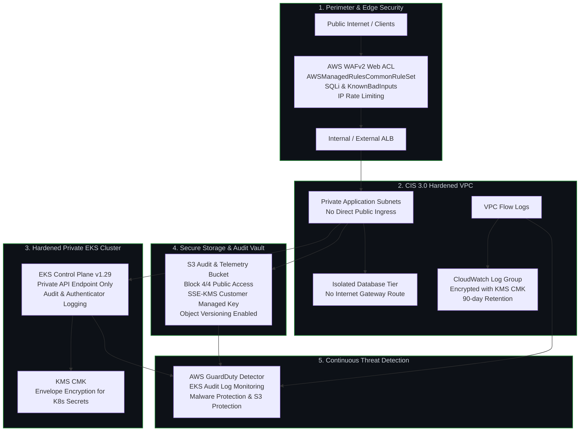

# Terraform AWS Security Baseline (CIS Benchmark 3.0)

[](https://github.com/huy8114644/terraform-aws-security-baseline/actions/workflows/tf-security-scan.yml)
[](https://www.cisecurity.org/benchmark/amazon_web_services)
[](https://checkov.io)
[](https://opentofu.org)
[](LICENSE)

Production-grade **Terraform / OpenTofu Enterprise Modules** engineered to strictly satisfy the **CIS AWS Foundations Benchmark v3.0.0**, validated automatically via Checkov, tfsec, and tflint in CI/CD.

---

## 🎯 Problem Statement & Core Value

Over 80% of cloud security breaches originate from Infrastructure as Code (IaC) misconfigurations — such as unencrypted storage buckets, public Kubernetes API endpoints, missing audit flow logs, or exposed administrative ports.

This repository provides reusable, hardened Terraform modules establishing an enterprise security foundation with zero configuration drift:
1. **Zero Public Ingress by Default:** VPC Flow Logs, private endpoints for EKS, and isolated database subnets.
2. **KMS Envelope Encryption:** Customer Managed Keys (CMK) enforcing AES-256 GCM encryption for S3 objects, EKS secrets, and CloudWatch logs.
3. **Automated Perimeter Defense:** Managed AWS WAFv2 Web ACL preventing SQL injection, cross-site scripting, and volumetric HTTP abuse.
4. **Threat Intelligence:** AWS GuardDuty multi-account detector with automated EKS audit log analysis.

---

## 🏛️ Architecture Overview



---

## 🔒 Hardened Infrastructure Modules

### 1. Hardened VPC Module (`modules/vpc/`)
- **VPC Flow Logs:** Enabled for all traffic, streaming directly to encrypted CloudWatch Log Groups.
- **Subnet Tiering:** Isolated database tiers with zero Internet Gateway egress.
- **VPC Endpoints:** S3 and DynamoDB gateway endpoints enabled to prevent traffic from leaving the AWS private backbone.

### 2. Hardened EKS Cluster (`modules/eks/`)
- **Private API Endpoint:** `endpoint_public_access = false` with private Bastion / VPN access only.
- **KMS Envelope Encryption:** All Kubernetes secrets are encrypted at rest using dedicated Customer Managed Keys (CMK).
- **Cluster Logging:** API server, audit logs, and authenticator logs streamed to CloudWatch with retention policies.

### 3. Secure S3 Bucket Baseline (`modules/s3/`)
- **Block Public Access:** All 4 public access block settings enforced globally.
- **Encryption:** Server-Side Encryption with Customer Managed KMS Keys (SSE-KMS).
- **Audit & Versioning:** Object versioning enabled with S3 Server Access Logging.

### 4. Modular AWS WAFv2 Web ACL (`modules/waf/`)
- **AWS Managed Rule Sets:** AWSManagedRulesCommonRuleSet and AWSManagedRulesKnownBadInputsRuleSet.
- **Layer 7 Rate Limiter:** Per-IP request threshold blocking brute-force and scraping attacks.

### 5. Multi-Account GuardDuty (`modules/guardduty/`)
- Real-time continuous analysis of CloudTrail management events, VPC Flow Logs, and EKS audit logs.

---

## ⚙️ Module Variables & Configuration

### Hardened VPC (`modules/vpc/`)
| Variable | Type | Default | Description |
|---|---|---|---|
| `cidr_block` | String | `"10.0.0.0/16"` | Supernet CIDR block for the VPC |
| `environment` | String | `"prod"` | Target environment tag |
| `kms_key_arn` | String | `null` | KMS Key ARN for Flow Logs CloudWatch encryption |

### Hardened EKS Cluster (`modules/eks/`)
| Variable | Type | Default | Description |
|---|---|---|---|
| `environment` | String | `"prod"` | Deployment environment name |
| `cluster_role_arn` | String | Required | IAM Role ARN for EKS Control Plane |
| `private_subnet_ids` | List(String) | Required | Private subnet IDs for worker node placement |
| `kms_key_arn` | String | Required | Customer Managed KMS Key for envelope encryption |

### Secure S3 Bucket (`modules/s3/`)
| Variable | Type | Default | Description |
|---|---|---|---|
| `environment` | String | `"prod"` | Target deployment environment |
| `account_id` | String | Required | AWS Account ID for globally unique bucket naming |
| `kms_key_arn` | String | Required | Customer Managed KMS Key for SSE-KMS |

---

## 🚀 Local Developer Quickstart

Standardized operational tasks are automated via the included `Makefile`:

```bash
# 1. View all available Makefile commands
make help

# 2. Check code formatting against canonical style
make fmt

# 3. Validate syntax across all Terraform modules
make validate

# 4. Run Checkov CIS AWS Foundations Benchmark compliance scan
make scan

# 5. Clean local caches
make clean
```

### Local Verification with LocalStack
```bash
# Start LocalStack community container
docker run --rm -d -p 4566:4566 -e SERVICES=s3,ec2,kms,cloudwatch localstack/localstack

# Validate provisioning against LocalStack endpoint
tflocal init
tflocal plan
```

---

## 📄 License
This project is licensed under the MIT License - see the [LICENSE](LICENSE) file for details.
