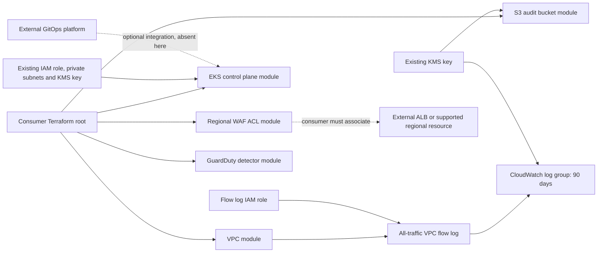
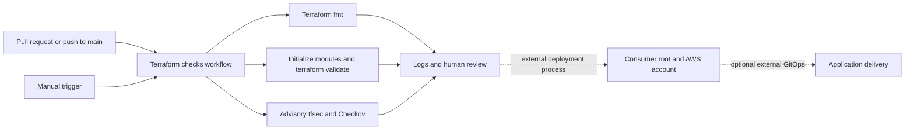

# Terraform AWS Security Baseline

Reusable AWS infrastructure examples for reviewing security controls in Terraform. The five modules define a VPC with flow logging, a private EKS control plane, an encrypted S3 bucket, a regional WAF ACL, and a GuardDuty detector. This portfolio demonstrates IaC design and review; it does not establish a deployed environment or CIS certification.

## Architecture and scope



These are independent modules, with no deployment root or wiring between them. The VPC module creates no subnets, routes, internet gateways or VPC endpoints. Its flow log IAM role still needs delivery permissions before operational use. EKS creates no nodes, IAM role, network or KMS key; its Kubernetes version is fixed at `1.29`, which must be reviewed against current regional support before deployment. S3 enables versioning, SSE-KMS and all four public access blocks; access logging and an HTTPS-only bucket policy are absent. WAF includes an IP rate limit of 1,000 and `AWSManagedRulesCommonRuleSet`, with no resource association or logging destination. GuardDuty enables S3, Kubernetes audit and EBS malware data sources for one account and region; organization enrollment and response automation are absent. Tags mentioning compliance express intent and are not evidence.

## CI and delivery



The workflow runs formatting, module validation and security scans without AWS credentials. Checkov and tfsec currently use `soft_fail: true`, so security findings do not fail those jobs; Checkov SARIF upload also permits failure. TFLint runs through local `make lint` but is absent from the current workflow, which has no scheduled trigger. Local `make scan` fails on findings and differs from CI. There is no apply, deployment, live drift detection, or demonstrated GitOps integration. The historical files in [`reports/`](reports/README.md) contain constant scores from a retired generator, not audit results. The workflow no longer generates or commits those claims. A green workflow does not certify CIS conformance or clean security scans.

## Inputs

Types and defaults below match the module declarations. Required values have no placeholder defaults.

| Module | Variable | Type | Default | Purpose |
|---|---|---|---|---|
| vpc | `cidr_block` | `string` | `"10.0.0.0/16"` | VPC CIDR |
| vpc | `environment` | `string` | `"prod"` | Names and tags |
| vpc | `kms_key_arn` | `string` | Required | Existing KMS key authorized for CloudWatch Logs |
| eks | `environment` | `string` | `"prod"` | Cluster name and tags |
| eks | `cluster_role_arn` | `string` | Required | Existing EKS control plane IAM role |
| eks | `private_subnet_ids` | `list(string)` | Required | Existing private subnets across at least two availability zones |
| eks | `kms_key_arn` | `string` | Required | Existing key for Kubernetes secrets |
| s3 | `environment` | `string` | `"prod"` | Bucket prefix and tags |
| s3 | `account_id` | `string` | Required | Account ID used in bucket name |
| s3 | `kms_key_arn` | `string` | Required | Existing key for SSE-KMS |
| guardduty | `environment` | `string` | `"production"` | Detector tags |
| waf | `environment` | `string` | `"production"` | ACL name, metrics and tags |

Each module requires Terraform `>=1.6, <2` and AWS provider `~>5.100.0`. The compatibility range is not a claim of OpenTofu testing. Modules currently expose no outputs. Consumer roots must configure the AWS provider, account, region, input values, backend and credentials. Key policies and IAM permissions must match the services using them.

## Local quickstart

Install Git, GNU Make, Terraform 1.9.8, TFLint 0.55.1, Checkov 3.2.471 and tfsec 1.28.14. Python 3.12 with `pip install checkov==3.2.471` installs Checkov. Use the official Terraform, TFLint and tfsec release installers for your OS. Provider initialization requires registry network access; no AWS credentials are needed for the following checks:

```bash
git clone https://github.com/huy8114644/terraform-aws-security-baseline.git
cd terraform-aws-security-baseline
make help
make lint
make test
make scan
```

`make test` runs formatting and provider-schema validation for every module. It does not provision resources or assert runtime behavior. Missing tools, initialization errors, validation failures and scanner findings return nonzero exit codes. No security checks are silently skipped.

For Terraform-only verification with Docker instead of a host installation:

```bash
docker run --rm -v "$PWD:/work" -w /work hashicorp/terraform:1.9.8 fmt -check -recursive
for module in modules/*; do
  docker run --rm -v "$PWD:/work" -w /work hashicorp/terraform:1.9.8 -chdir="$module" init -backend=false -input=false || exit 1
  docker run --rm -v "$PWD:/work" -w /work hashicorp/terraform:1.9.8 -chdir="$module" validate || exit 1
done
```

A plan requires a consumer root with module blocks, real inputs, provider configuration, credentials and access to its state backend. This repository's `environments/production` has no configuration and is not a runnable example. After creating and reviewing your root, run `make plan ROOT_DIR=/absolute/path/to/root`. Terraform may query AWS during planning; no apply target is provided. LocalStack provisioning is not implemented or verified here. Keep state, saved plans, credentials and `.tfvars` files out of commits. `make clean` removes provider caches while retaining dependency lock files.

## Contributing

See [CONTRIBUTING.md](CONTRIBUTING.md) for branch conventions, local checks and review evidence. This project is licensed under [MIT](LICENSE).
